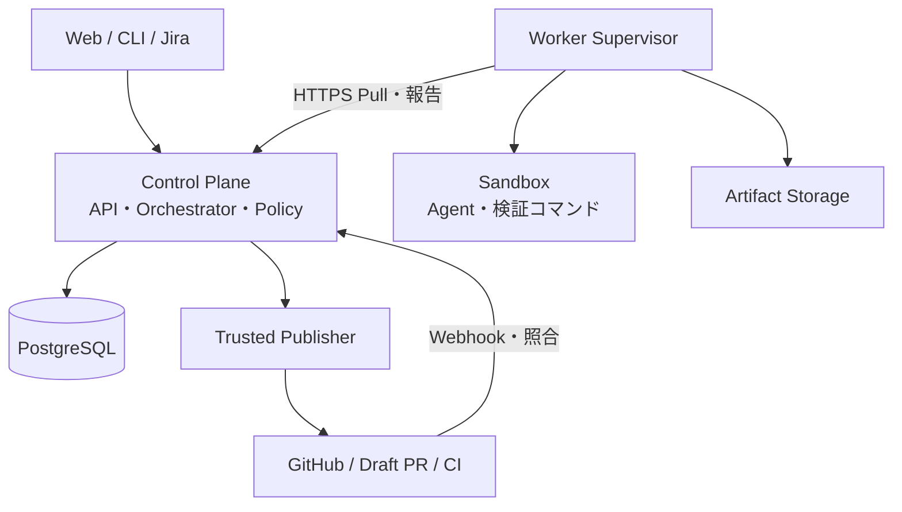
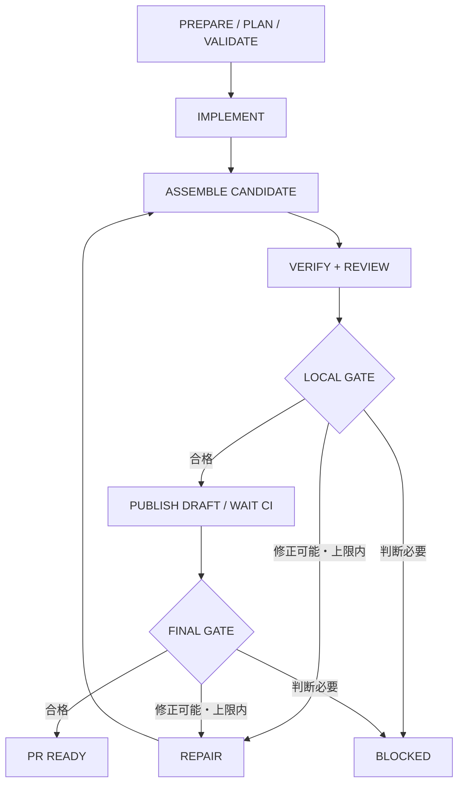

# ソフトウェアファクトリー 設計書

**Version 0.4｜議論統合版｜2026-11-02**

## 開発自動化から、自律的なプロダクト改善へ

人間が目的と制約を定め、AIが計画・実装・検証を進める。工程・権限・品質・費用は、決定論的な制御基盤が管理する。

**最初の到達点：人間によるコード修正なしで、検証済みDraft PRを引き渡す。**

| 項目 | 本資料の位置づけ |
|---|---|
| 対象 | 個人用から開始し、将来はチーム・外部ユーザーへ提供する開発基盤 |
| 構成 | Control PlaneとWorkerを分離したハイブリッド型 |
| 現在地 | 設計ドラフト。実装・性能・安全性の検証は未実施 |
| 合意事項 | 開発自動化を先行し、自律型プロダクト開発へ拡張する方向性 |
| 技術仕様 | 本会話で提案した設計を統合した採用候補。細部は実装前レビュー対象 |
| 原資料 | この会話の企画・機能要件・アーキテクチャ議論 v0.1〜v0.4 |

## 読み方

01〜04で方針・要件・構成、05〜08で実行と検証、09〜11で通信・API、12〜16でデータ・復旧・安全性・運用、17〜18で実装計画と残課題を確認する。付録にTaskSpecとAPIペイロード例を収録する。

**設計原則：AIが失敗しても、何が起きたか説明でき、安全に止まり、必要な地点から再開できる。**

本資料は議論の整理であり、外部製品の最新機能やSDKの提供状況を保証するものではない。既存回答に含まれていた外部企業の事例や、未検証の製品仕様は設計の根拠として採用していない。

<!-- pagebreak -->

# 01｜目的・範囲・合意事項

## 合意済みの方向性

| 項目 | 方針 |
|---|---|
| 長期目標 | 開発自動化と、自律的な企画・運用・改善の両方を目指す |
| 開始点 | 人間が要求を与え、AIが実装・検証してPRを用意する開発自動化 |
| 利用者 | 最初は個人。将来はチーム、さらに外部ユーザーへ提供 |
| 配置 | ハイブリッド型。初期はローカル、将来はクラウドControl Planeと各種Worker |

## MVPの範囲

単一Workspace、少数のProject、1つのImplementation Unit、Workerの実行スロット1を起点とする。TaskSpecを入力として、計画、実装、独立検証、上限付き修正、Draft PR作成、CI確認、結果通知までをつなぐ。

JiraやSlackはAdapterとして接続する。コアはJiraがなくても、APIまたはCLIから同じTaskSpecで実行できるようにする。既存の個別プロダクトに専用化しない。

**MVPの成功 = 必要な検証を通過したDraft PRを人間へ引き渡したこと。マージ・本番公開は含まない。**

## 初期スコープ外

自動マージ、本番デプロイ、自律的な市場調査、無制限の子Agent起動、複数Unitの並列実装、課金SaaS、企業向けSLAは初期MVPには含めない。データと権限の境界は、将来の追加に備えて設ける。

## 用語と終了条件

| 用語 | 定義 |
|---|---|
| Workspace | 利用者・権限・データ・予算を分離するテナント境界 |
| Task | 達成したい要求。実行履歴とは分離する |
| Run | 固定した仕様とポリシーで行う一連の開発試行 |
| Candidate | 検証対象として確定した、変更不能なコードの版 |
| VERIFIED_DRAFT_PR | Runの成功成果。現在のPR状態は別途追跡する |

Run成功後にPRへ追加コミットされた場合、過去の成功履歴は残すが、追加後のコードを検証済みとは扱わない。

<!-- pagebreak -->

# 02｜機能要件と評価指標

## MVP機能要件

| ID | 機能 | 最低限の完成条件 |
|---|---|---|
| FR-01 | Workspace・Project・Repository管理 | 全操作をWorkspace境界で認可する |
| FR-02 | 要求とTaskSpecの版管理 | 目的・受け入れ条件・制約を構造化して固定できる |
| FR-03 | 計画生成・検証 | AIの計画を検証し、許可された工程だけ採用する |
| FR-04 | 永続ジョブ管理 | 依存関係、Lease、再試行、再開を保存する |
| FR-05 | 隔離実行・Agent Adapter | 単一Agentを使い捨て環境で起動・停止できる |
| FR-06 | Candidate管理 | コード版と検証証拠を一対一に追跡できる |
| FR-07 | 独立した品質ゲート | テスト・レビュー・必須条件をサーバーが判定する |
| FR-08 | 上限付き修正 | インフラ再試行とコード修正を区別して制限する |
| FR-09 | PR公開・CI連携 | 専用PublisherがDraft PRを作成・更新し照合する |
| FR-10 | 人間の介入 | 計画承認、予算変更、キャンセルの対象を固定する |
| FR-11 | ログ・監査・費用 | Run単位で経緯、証拠、消費量を確認できる |
| FR-12 | 外部連携 | Jira入力・Slack通知をコアと分離して接続する |

## 非機能要件

状態は再起動後も復元し、WorkerからDBへ直接アクセスさせない。通常は外向きHTTPSのみでWorkerを接続する。秘密情報、Artifact、キャッシュ、ログの参照にもWorkspace境界を適用する。

再送を通常事象として扱い、重複Job・重複PR・古い証拠の採用を防ぐ。検証不能な状態は成功ではなくERRORまたはINCONCLUSIVEとする。バックアップ、復元手順、保持期間は運用開始前に具体化する。

## 成果の測り方

主指標は「人間のコード修正なしで、必須品質ゲートを通ったDraft PRまで到達したRunの割合」とする。対象期間、対象タスク種別、キャンセル・仕様変更の件数を併記し、都合のよいRunだけを分母に選ばない。

補助指標として、総費用、実行時間と待機時間、修正回数、手動介入回数、マージ後の不具合、検証不足による差し戻しを記録する。数値目標は基準データ取得後に設定する。

<!-- pagebreak -->

# 03｜システム構成と責務境界

Control Planeはモジュラーモノリス、Workerは独立プロセスとして開始する。Verification Planeは論理的に独立させるが、初期から別サービスに分割する必要はない。



| 責務 | Control Plane | Worker Supervisor / Agent |
|---|---|---|
| 要求・計画・権限 | 正本を管理し、工程を決定 | 必要な入力だけ取得する |
| 割り当て・再試行 | 能力・認可・予算・優先度で決定 | Claimし、期限内で実行する |
| 実作業 | 実行条件を固定する | Supervisorが環境管理、Agentが編集する |
| 品質 | 証拠を集約して合否を確定 | テスト・レビュー結果を提出する |
| 公開 | 専用Publisherが実行する | AgentにGitHub書き込み権限を渡さない |
| 障害復旧 | 再割り当てと外部状態照合 | 停止、再接続、同一要求の再送 |

**初期技術案：Python / FastAPI、PostgreSQL、ローカルArtifact Storage、Codex等のAgent Adapter。UIは最小限から始める。** SDKの有無・言語対応を前提に固定せず、CLI等も含めてAdapterで吸収する。

将来はControl PlaneとDBをクラウドへ移し、Workerをローカル・クラウドに配置する。API境界は維持するが、認証、TLS、テナント隔離、Artifact転送、秘密情報管理の本番対応は別途必要となる。

<!-- pagebreak -->

# 04｜Orchestrator内部設計

## 6つの責務

| モジュール | 責務 | 禁止する責務混在 |
|---|---|---|
| Run Compiler | 仕様・基準SHA・設定・ポリシーを固定 | コード生成や実行中の暗黙変更 |
| Plan Validator | 計画を検証して許可工程へ変換 | AI提案の無条件採用 |
| Transition Engine | 状態とイベントから次の処理を決定 | LLMや外部APIへの直接アクセス |
| Scheduler | 依存・能力・予算・並列数から実行可否を決定 | 品質合格の判断 |
| Gate Evaluator | 証拠から合格・修正・停止を決定 | 自分で候補コードを修正すること |
| Reconciler | Lease失効、欠落通知、結果不明操作を復旧 | 根拠なく成功へ変更すること |

```text
Decision = decide(RunSnapshot, DomainEvent, PolicySnapshot)
```

Transition Engineは、同じ入力に同じDecisionを返す純粋な判定部分として実装する。現在時刻や外部状態も明示的な入力にし、Agentなしで分岐を試験できるようにする。

## Run開始時に固定する情報

| 対象 | 保存内容 |
|---|---|
| 要求・ソース | TaskSpec版とハッシュ、Repository ID、base_sha |
| 手順 | workflow_type、workflow_version |
| 実行 | Agent設定、実行イメージのdigest、時間・費用上限 |
| 検証 | 必須チェック、受け入れ条件対応、検証環境 |
| 権限 | 適用Policy版と実効権限のスナップショット |

緊急停止、認証失効、権限取り消しはスナップショットより優先し、その時点から適用する。開始時に許可されていたことは、取り消し後の実行根拠にはしない。

## 状態更新の境界

Run単位で競合を制御し、状態更新、次Job作成、イベント処理済み記録、Outbox追加を短いDBトランザクションで確定する。LLM・GitHub・Long Pollingの待機中にDBロックを保持しない。

CI待ち、承認待ち、再試行時刻待ちはDBに保持する状態であり、Workerや常駐実行スレッドを占有しない。

<!-- pagebreak -->

# 05｜MVPの実行ワークフロー



| 工程 | 実行主体・出力 |
|---|---|
| PREPARE | Compilerが実行条件と基準コードを固定 |
| PLAN / VALIDATE | Plannerが計画を提案し、Validatorが採否を決定 |
| IMPLEMENT / REPAIR | 隔離Agentが変更Artifactを提出 |
| ASSEMBLE CANDIDATE | 隔離作業環境で変更を適用し、候補を固定 |
| VERIFY / REVIEW | 候補に対する独立検証と構造化された指摘 |
| LOCAL / FINAL GATE | 必須証拠とPolicyからControl Planeが判定 |
| PUBLISH / WAIT CI | PublisherがPR操作。CI待ちはDB状態として保持 |

図は正常系と修正分岐の概要である。計画不正、検証基盤故障、キャンセル、予算超過は本文のエラー規約で処理する。VERIFYとREVIEWは論理的に並列可能だが、初期1スロットでは直列でよい。

Run状態の候補はQUEUED、RUNNING、WAITING_EXTERNAL、BLOCKED、CANCELLING、SUCCEEDED、FAILED、CANCELLEDとする。進行工程を表すphaseは別フィールドとし、状態名に工程と結果を混在させない。

<!-- pagebreak -->

# 06｜TaskSpec・Plan・Agentの契約

## TaskSpecは工場の実行契約

自由文を残しながら、目的、受け入れ条件ID、制約、入力Repository、検証条件、実行上限を構造化する。TaskSpecの変更は新バージョンとして保存し、実行中Runへ黙って反映しない。

クライアントが記述する権限や予算は要求値であり、Workspace Policyを上書きできない。実効条件はサーバー側で導出する。base_refはRun開始時に解決してbase_shaを固定する。

## Planner出力と検証

| 出力 | 検証内容 |
|---|---|
| units / objective | MVPではImplementation Unitが1つであること |
| acceptance_ids | 必須受け入れ条件を漏れなくカバーすること |
| depends_on | 循環・不明参照がなく、同一Run内であること |
| proposed_write_paths | Project/Workspaceの許可範囲内であること |
| assumptions / open_questions | 実装を妨げる未解決判断がないこと |

AIは必須テストの削除、権限追加、予算増額を決定できない。認証、課金、DB移行、CI設定などは高リスク変更として検出し、計画と実差分の両方で確認する。

## 成果物を介した役割分担

| 役割 | 入力 | 出力 |
|---|---|---|
| Planner | TaskSpec・規約・制約 | 構造化Plan |
| Implementer | 採用Plan・基準コード | 変更Artifact・概要・自己テスト |
| Verifier | Candidate・固定検証条件 | テスト結果・証拠Artifact |
| Reviewer | TaskSpec・差分・周辺コード | 条件別評価・指摘・証拠 |
| Repairer | Candidate・採用指摘・制約 | 修正Artifact・対応指摘ID |

自由なAgent間会話を制御の正本にせず、Control Plane管理の成果物で引き継ぐ。レビュー指摘はfinding_id、candidate_id、criterion_id、severity、location、evidence_artifact_idsを持つ。

Agent Adapterはstart / events / cancel / resultを共通契約とし、再開能力等はCapabilitiesで宣言する。役割ごとの常駐Agentは不要。将来のタスク分割も、職種ではなく独立して検証できる変更単位で行う。

<!-- pagebreak -->

# 07｜Candidate・独立検証・品質ゲート

## Candidateを変更不能にする

修正後は新しいCandidateを作り、旧Candidateのコードや検証結果を上書きしない。提出Artifactをそのまま採用せず、組み立て・差分検査を通して確定する。

| 固定する識別情報 | 目的 |
|---|---|
| base_sha / head_sha | 基準コードと候補コードの特定 |
| source_artifact_digest | 提出物・組み立て結果の追跡 |
| task_spec_hash | どの要求を検証したかの特定 |
| verification_profile_hash | 検証条件の固定 |
| execution_image_digest | 実行・検証環境の特定 |

テスト、レビュー、Gate判定、人間の承認は必ずCandidateに結び付ける。外部CIがテスト用マージコミットを検証した場合は、実際の検証SHAとbase/headの組み合わせも保存する。

## 独立性の要件

実装Agentが検証条件を管理できないこと、新しい環境で候補を検証すること、証拠と対象コードを照合できることを重視する。別モデルでレビューするだけでは十分としない。

Agentによるテスト追加は許可するが、必須チェックの削除・無効化、検証対象削減、合格基準緩和は別承認とする。CI設定・認証・実行権限を変更する差分も通常ラインから分離する。

| Gate結果 | 意味 | 次の処理 |
|---|---|---|
| PASS | 必須証拠がそろい条件を満たす | 次工程へ |
| FAIL | 不具合・仕様違反を確認 | 上限内ならRepair |
| ERROR | 検証基盤や実行が故障 | 同一入力のインフラ再試行 |
| INCONCLUSIVE | 仕様曖昧・証拠不足・判断不能 | BLOCKEDで人間へ |

テスト未実行、タイムアウト、結果欠落をPASSへ変換しない。検証Jobの正常終了は、検証結果の合格を意味しない。

承認はaction、Candidate、証拠集合、Policy版に固定する。内容変更後は再検証・再承認する。外部ユーザーのWorkerが出した証拠と、管理された検証環境の証拠はevidence_originで区別する。

<!-- pagebreak -->

# 08｜Job・Attempt・Lease管理

| 概念 | 意味 | 変更時の扱い |
|---|---|---|
| Task | 達成要求 | 仕様版を追加できる |
| Run | 固定条件での開発パイプライン | 仕様の本質的変更は原則新Run |
| Job | 割り当て可能な作業単位 | コード修正は新しいRepair Job |
| Attempt | 同じJobを実行する試行 | Worker障害等で増加する |
| Lease | Attemptを実行する期限付き権利 | 再割り当て時に世代番号を増やす |

## 状態遷移案

```text
PENDING → READY → LEASED → SUCCEEDED
                     ├→ RETRY_WAIT → READY
                     ├→ FAILED
                     └→ CANCELLING → CANCELLED
```

依存完了でPENDINGからREADYに進む。READY取得時にJobをロックし、Attempt作成・Lease割り当て・予算予約を同一トランザクションで確定する。失効したAttemptはEXPIREDとして履歴に残す。

| 初期パラメータ案 | 値 |
|---|---|
| Long Polling | 最大20秒 |
| Lease / Heartbeat | 90秒 / 15秒 |
| 同一Jobのインフラ試行 | 最大3回、初回を含む |
| 修正ラウンド | 最大2回、初回実装とは別 |
| Job実行上限 | 45分 |
| Run内並列数 | 1 |

数値は仮の初期設定であり、SLAや性能保証ではない。Heartbeatの待機は残りLease時間を考慮し、Workerは確認できた実行期限より前に安全余裕を持って停止する。

## 有効性とfencing

Heartbeat・完了受付では、認証Worker、lease_id、fence、現在のAttempt、DB時刻での有効期限を検証する。古い世代・期限切れの未受理結果は409で拒否する。回収処理が遅れていても期限は延びない。

受理済み完了要求の同一再送は保存済みの結果を返す。fenceはDB上の受理制御であり、外部APIへの副作用を完全に防ぐ仕組みではない。PR操作には別の冪等性・照合を適用する。

<!-- pagebreak -->

# 09｜通信プロトコルとWorkerライフサイクル

## 接続モデル

WorkerはControl Planeへ外向きHTTPSで接続し、Long PollingでJobを取得する。Workerへの常設インバウンドポートは要求しない。ローカルHTTPを許す場合もループバック等の明示した開発範囲に限定し、LAN・クラウド越しはTLSを前提にする。

| 段階 | プロトコル上の動作 |
|---|---|
| 登録 | 管理者発行の一回限りEnrollment TokenでWorkerを登録 |
| 認証 | Worker IDと分離した認証情報を発行。更新・失効を可能にする |
| Claim | 認可・能力・空きスロットをサーバーが検証して割り当て |
| 実行 | SupervisorがSandboxを準備し、Agentを起動 |
| 維持 | HeartbeatでLease更新、停止要求・進捗を交換 |
| 提出 | Artifactアップロード完了後に、IDと結果を完了報告 |
| 終了 | 受理結果を確認し、Sandboxと一時秘密情報を破棄 |

Workerが申告するCapabilitiesは技術適合性の情報にすぎず、Workspaceアクセス権の根拠にはしない。全Worker APIでトークンの主体と対象Leaseを照合する。

## イベントと成果物

イベントはattempt_idとsequenceで重複排除する。Run内の表示順はサーバー側のイベント番号を使い、Worker時計だけで並び順を決めない。UI向けSSEはLast-Event-ID等による再開を扱う。

Artifactは作成予約、アップロード、確定の段階を分ける。サーバーが発行した保存先にだけ書き込ませ、任意のURIやパスを信用しない。サイズ、digest、所属、提出元Attemptを検証してからAVAILABLEにする。

大きなログ・パッチ・証拠はStorageに保存し、DBは参照とメタデータを保持する。完了報告はAVAILABLEなArtifact IDだけを受け付ける。期限切れアップロードは検疫・削除対象とする。

## 版互換

APIは/v1、Workerはprotocol_versionと実装版を宣言する。対応外のメジャー版は実行前に拒否し、未知の必須フィールドやイベント種別を黙って無視しない。詳細な互換ポリシーと認証更新方式は実装前に確定する。

<!-- pagebreak -->

# 10｜MVP Public API

人間、CLI、UI、連携Adapter向けAPI。Workerトークンでは呼び出せない認可スコープを設ける。以下は設計一覧であり、OpenAPIの確定版ではない。

| Method / Endpoint | 用途 |
|---|---|
| POST /v1/workspaces/{id}/projects | Project作成 |
| POST /v1/projects/{id}/repositories | Repository登録 |
| POST /v1/projects/{id}/tasks | Taskと初期仕様の作成 |
| GET /v1/tasks/{id} | Taskと実行履歴の取得 |
| POST /v1/tasks/{id}/spec-versions | 仕様の新バージョン作成 |
| POST /v1/tasks/{id}/runs | 指定仕様でRunを開始 |
| GET /v1/runs/{id} | 状態、phase、停止理由、費用 |
| GET /v1/runs/{id}/plan | 採用計画と版 |
| GET /v1/runs/{id}/graph | Jobと依存関係 |
| GET /v1/runs/{id}/events | SSEによる実行イベント購読 |
| GET /v1/runs/{id}/artifacts | 成果物一覧 |
| GET /v1/runs/{id}/candidates | Candidate履歴 |
| GET /v1/candidates/{id}/verification | 証拠とGate判定 |
| POST /v1/runs/{id}/interventions | 計画承認、予算変更、停止理由解消 |
| POST /v1/approvals/{id}/decision | 個別承認要求への意思決定 |
| POST /v1/runs/{id}/cancel | キャンセル要求 |
| GET /v1/workspaces/{id}/workers | Worker一覧・稼働状態 |

## 共通規約

作成は201、非同期開始・キャンセル受付は202を基本とする。Run開始はLocationで追跡先を返す。変更APIはIdempotency-Keyと要求ハッシュを保存し、同じキー・同じ要求の再送に同じ結果を返す。

同じキーで内容が異なる場合、古いstate_revisionに対する意思決定、有効でない状態遷移は409。入力不正は422、未認証は401。越境アクセスは情報漏えいを避ける応答方針を統一する。

interventionsとapprovals/decisionは同じ内部コマンド処理へ集約し、相互に制約を迂回できないようにする。承認にはaction、subject_id、expected_run_revision、reasonを必要とする。汎用の「承認済み」フラグは設けない。

<!-- pagebreak -->

# 11｜MVP Worker API

Worker IDは認証から導出する。リクエスト中の任意のWorkspace IDやWorker IDを信用して権限を切り替えない。

| Method / Endpoint | 用途・返却 |
|---|---|
| POST /v1/worker/enroll | 一回限りトークンで初回登録 |
| POST /v1/worker/claims | JobとLease取得。待機後に空なら204 |
| POST /v1/worker/leases/{id}/heartbeat | Lease更新とキャンセル要求取得 |
| POST /v1/worker/leases/{id}/events | sequence付きイベントのバッチ送信 |
| POST /v1/worker/leases/{id}/artifacts | アップロード先とArtifact IDを予約 |
| POST /v1/worker/leases/{id}/artifacts/{aid}/finalize | サイズ・digestを検証し提出を確定 |
| POST /v1/worker/leases/{id}/complete | 実行結果を冪等に受理 |
| POST /v1/worker/leases/{id}/fail | 原因分類と証拠を受理 |

## 応答契約

Claim成功時はjob_id、run_id、attempt_id、kind、仕様参照、入力Candidateまたはbase_sha、実効制約、Lease ID・fence・期限を返す。認証更新・失効APIの具体形は別途確定する。

HeartbeatはLeaseの残り有効時間とcancel_requestedを返す。キャンセル中には新しい実行権を付与せず、停止通知と状態確認を優先する。進捗率やAgentの自己申告から品質合格を決めない。

CompleteにはIdempotency-Key、fence、結果、Artifact IDを付ける。サーバーが既受理内容を照合した後、未受理なら現在のLeaseを検証する。トークン失効時の再照合は管理者側の手段も確保する。

## エラー規約案

| code | 意味 | Workerの対応 |
|---|---|---|
| LEASE_EXPIRED / STALE_FENCE | 実行権が失効した | 実行停止。結果の自動採用を要求しない |
| IDEMPOTENCY_CONFLICT | 同じ操作IDで内容が異なる | 新規操作にせず原因を報告 |
| ARTIFACT_NOT_READY | 提出物の確定が未完了 | 同一Artifactの状態を確認 |
| POLICY_DENIED | 許可された操作・範囲ではない | 自動権限昇格しない |
| PROTOCOL_UNSUPPORTED | 通信仕様の版が非対応 | Jobを開始せず更新を要求 |

429や一時的5xxは残りLeaseを考慮して再送する。通信失敗を理由に、期限後も無期限にAgentを走らせない。

<!-- pagebreak -->

# 12｜データモデルと正本

全ての業務データにWorkspace境界を持たせる。グローバルなUser等を除き、親子参照はworkspace_idが一致する制約を設ける。IDを知っているだけで参照できる設計にしない。

| テーブル群 | 主なテーブル・責務 |
|---|---|
| 所有・認可 | workspaces、users、workspace_memberships、projects、repositories |
| 要求・計画 | tasks、task_spec_versions、plan_versions |
| 実行 | runs、jobs、job_dependencies、job_attempts |
| Worker | workers、worker_authorizations、認証情報の参照 |
| 成果物 | artifacts、candidates |
| 検証・承認 | verification_checks、gate_evaluations、approvals |
| イベント | run_events、audit_events、inbox_events、outbox_events |
| 外部操作 | external_operations、integration_deliveries |
| 費用 | usage_records、budget_reservations |
| 再送 | api_idempotency_records：主体・操作・キー・要求hash・応答 |

## 中核となる関連

```text
Workspace → Project → Task → TaskSpec versions
                         └→ Run → Plan versions
                                ├→ Jobs → Attempts → Artifacts
                                ├→ Candidates → Checks → Gates
                                ├→ Approvals / Interventions
                                └→ External operations / Usage
```

RepositoryはProjectに所属する。Runは実行時のRepositoryと基準SHAを固定する。複数Repositoryの同時変更はMVPの対象外とするが、ProjectとRepositoryの関係は分離しておく。

## 主要な一意性・整合性

| 制約 | 目的 |
|---|---|
| Task + spec_version | 同一仕様版の重複を防ぐ |
| Run + step_key | 同じ工程Jobを二重生成しない |
| Job + attempt_no | 同一試行番号を重複させない |
| Attempt + sequence | Workerイベントを重複排除する |
| 主体 + 操作 + Idempotency-Key | API要求の再送を識別する |
| Provider + Integration + delivery_id | Webhookの重複を識別する |
| Workspace一致の複合FK | 親子間の越境参照を防ぐ |

RLSは防御層として検討するが、それだけでArtifact・秘密情報・Workerの隔離が完成するわけではない。接続プールでのテナント文脈の漏れもテスト対象とする。

<!-- pagebreak -->

# 13｜DB操作・排他・状態遷移

## Claimは短いトランザクションで確定する

以下は実装意図を示すSQL骨格であり、そのまま実行する本番DDL・クエリではない。認可、能力照合、空きスロット、費用予約、最大試行数などの条件を省略しない実装が必要となる。

```sql
BEGIN;
-- 先にWorkerスロットと予算枠を固定順序でロックする。
SELECT id
FROM jobs
WHERE workspace_id = :authorized_workspace_id
  AND state = 'READY'
  AND available_at <= :db_now
  AND attempt_no < max_attempts
ORDER BY priority DESC, available_at, created_at, id
FOR UPDATE SKIP LOCKED
LIMIT 1;

-- 選択したJobについて、同じTX内で以下を行う。
-- 1. 認可・能力・依存・Run状態・予算を再確認する
-- 2. attempt_no / lease_fenceを増やしLeaseを設定する
-- 3. job_attempts、予算予約、監査イベントを作成する
COMMIT;
```

候補がなければトランザクションを終了し、その後Long Pollingで待つ。20秒の待機をDB行ロックの中に置かない。Workerスロットと予算枠は競合時も二重確保しない。

## Transition Engineの反映

```text
BEGIN
  Inboxでイベント重複確認
  Runをロック、またはstate_revisionで楽観排他
  現在状態と入力対象を検証
  Decisionを適用して状態と次Jobを更新
  処理済みイベントとOutboxを追加
COMMIT
```

同じ完了イベントが重複・逆順で届いても、Jobの一意キーと状態条件で次工程を一度だけ作る。全イベント再生を正本にする完全なEvent SourcingはMVPに要求せず、現在状態と監査履歴を併存させる。

## インデックス案

READY取得用はstateの部分条件付きでpriority / available_at / created_at / id、失効回収用はLEASED等の実行状態に対するlease_expires_at、一覧取得用はworkspace_id / run_id / created_atを検討する。実データの実行計画で見直す。

<!-- pagebreak -->

# 14｜障害復旧・冪等性・外部副作用

## 障害ごとの復旧規約

| 状況 | 復旧動作 |
|---|---|
| Worker停止・Lease失効 | AttemptをEXPIREDにし、上限内なら再試行 |
| 完了保存後に応答だけ消失 | 同じ操作ID・内容の再送へ保存済み結果を返す |
| 古いWorkerの遅延報告 | 未受理なら拒否。候補や証拠として採用しない |
| Control Plane再起動 | DBから実行・待機・停止理由を復元 |
| Webhook欠落・重複 | Inboxで重複排除し、定期照合で欠落を補う |
| 古いCandidateのCI完了 | 該当候補の履歴にのみ記録し、現候補に流用しない |
| Artifact提出途中の中断 | 未確定状態を維持し、保持期限後に回収 |

## PR公開の操作台帳

```text
PENDING → IN_FLIGHT → SUCCEEDED
                  └→ UNKNOWN → RECONCILING
```

PublisherはRunごとの既定ブランチを使い、修正時は同じDraft PRを更新する。操作キーにRepository、Run、対象Candidate、操作種別を含め、公開前に最新Candidate・Gate・キャンセル状態を再確認する。

PR作成後に応答が消えた場合、新しいPRを即座に作らない。操作識別子、ブランチ、GitHub上の実状態を照合する。判定不能ならUNKNOWNのまま停止し、人間の確認対象にする。

Outboxは状態更新と通知要求の保存をそろえるために使う。配送の完全な一回性を仮定せず、受信側も冪等化する。DBと外部APIの間の完全なexactly-onceを保証として掲げない。

## キャンセルの意味

API受付後はCANCELLINGにし、新規Job割り当て・未開始公開を止める。実行中Workerへ停止要求を返し、停止確認または実行権失効後に論理的な終端へ進める。

通信不能なWorkerの物理停止は断定しない。論理的な実行権失効と、プロセス停止確認を別項目で記録する。既に外部送信されたPR操作は取り消せると仮定せず、照合して結果を表示する。

<!-- pagebreak -->

# 15｜セキュリティ・認証・テナント境界

## 権限の分離

| 境界 | 必須制約 |
|---|---|
| User → Control Plane | Workspaceと操作単位で認可する |
| Worker → Control Plane | Worker専用認証、許可WorkspaceとLeaseに限定 |
| Worker → DB | 直接接続を禁止する |
| Agent → ホスト | ホーム、SSH鍵、Dockerソケット、CP認証情報を渡さない |
| Agent → GitHub | 書き込み権限を持たせず、変更Artifactを提出させる |
| Publisher → GitHub | 対象Repository・操作権限を限定し、短命資格情報を使う案 |
| Workspace間 | DB、Artifact、秘密情報、キャッシュ、ログを分離する |

Worker SupervisorとAgent Runtimeを分離する。生成コードと入力Repositoryは非信頼として扱い、SupervisorやControl Planeの権限をプロンプトから変更できないようにする。

Project規約やRepository内の指示を、Workspaceの権限・予算・必須検証より優先しない。外部コンテンツによる指示注入は、権限拡大や秘密情報取得の根拠にしない。

## 実行・公開の安全性

使い捨てSandbox、最小マウント、CPU・メモリ・時間制限、必要先に限定したネットワークを採用候補とする。外部ユーザー向けはVM等のより強い隔離を別途評価し、個人用コンテナ構成を安全保証として転用しない。

Publisherの差分適用は隔離環境で行い、パストラバーサル、シンボリックリンク、フック、許可外パスを確認する。Control Planeプロセスで非信頼コードやビルドを実行しない。ログは秘密情報をマスクし、Artifactも検疫・保持期限を持つ。

## ハイブリッド構成のデータ持ち出し

ローカルWorkerでも、外部LLMへのコード送信、クラウドStorageへのArtifact転送は起こり得る。コードArtifact、ログ、モデルへのコード送信の可否をProject設定で分ける。

「ローカルだからコードは外に出ない」とは表示しない。厳密なコード非送信モードは、モデル・検証・Publisherの配置まで定義してから提供する。

<!-- pagebreak -->

# 16｜修正制御・予算・運用

## 再試行と修正を混ぜない

| 原因 | 対応 | 新しく作るもの |
|---|---|---|
| 通信断、Worker停止、一時障害 | 同じ入力で再試行 | 同じJobのAttempt |
| 不具合・仕様違反 | Repairを実行 | 新しいJobとCandidate |
| 要求の不足・本質的変更 | 仕様を再定義 | 新Spec。原則新Run |
| 権限不足・禁止操作 | 人間の判断待ち | 自動権限昇格しない |
| 予算上限 | 実行を停止 | 承認後に予約枠を更新 |

同じ候補digest、同じ失敗の反復、改善の証拠なし、仕様変更が必要な場合は、回数上限前でも停止する。Agentの「もう少し」という自己申告では上限を延長しない。

## 予算予約

```text
開始可能額 = 費用上限 - 確定費用 - 実行中Jobの予約額
```

Job開始前に予算を予約し、終了時に精算する。モデル呼び出し・Agent内部ツールも集計対象にする。費用の遅延報告や利用者保有認証情報では、完全な課金上限は保証しない。

強い上限保証が必要なら、管理されたModel Gatewayと呼び出し単位の制限を別途導入する。実行時間上限、モデル利用量上限、外部Providerの実請求を区別して記録する。

## オペレーション画面の最低要件

Run状態とphase、停止理由、現在のCandidate、検証結果、PR/CI状態、費用、再試行・修正回数を一覧化する。失敗時は、未解決条件、試した修正、証拠、人間に必要な判断を表示する。

Workerの未応答は「停止」と断定せず、最終HeartbeatとLease状態を示す。停止確認済み、権利失効、接続不能を区別する。緊急停止・Worker失効・実行再開は監査対象とする。

バックアップと復元試験、Artifact保持、秘密情報ローテーション、失効Lease・未確定Artifactの回収、Webhook再同期を運用手順に含める。RPO/RTOや保存日数は現時点では未確定である。

<!-- pagebreak -->

# 17｜実装計画とMVP受け入れ試験

## 実装の順序

| 順序 | 実装範囲 | 終了条件 |
|---|---|---|
| 1 | Orchestrator Core、DB、Lease、Fake Agent | 成功・失敗・待機・キャンセルの分岐を再現できる |
| 2 | Candidate、証拠、Gate | 古い候補や不足証拠では合格できない |
| 3 | 上限付きRepair、予算予約 | 無限ループせず理由付きで停止する |
| 4 | Publisher、CI同期、外部操作台帳 | 応答消失でも重複PRを作らない |
| 5 | 実Agent、Sandbox、Jira/Slack連携 | 小さな実タスクでPR引き渡しまで完走する |

実Agentを接続する前にFake Agentで制御系を検証する。障害復旧・認可・冪等性を最後の追加機能にせず、基盤の受け入れ条件に含める。

## 必須の障害・安全性テスト

| ID | シナリオ | 期待する結果 |
|---|---|---|
| AT-01 | Worker強制終了 | Lease失効後、上限内で再割り当て |
| AT-02 | 完了応答だけ消失 | 同一再送に受理済み結果を返す |
| AT-03 | 旧Attemptの遅延報告 | 現候補・現検証として採用しない |
| AT-04 | 検証とレビューが同時完了 | 次工程は一度だけ作る |
| AT-05 | 旧候補のCI結果が遅延 | 新Candidateの合格には使わない |
| AT-06 | Agentが必須テストを削除 | 通常ラインを停止する |
| AT-07 | 修正後も候補が同一 | 無意味な修正を打ち切る |
| AT-08 | PR作成直後にPublisher停止 | 既存PRと照合し重複作成しない |
| AT-09 | キャンセルと公開の競合 | 未開始公開を抑止し、送信済みは照合 |
| AT-10 | Control Plane再起動 | 実行・待機・停止理由を復元 |
| AT-11 | 別Workspaceの認証 | Task・ログ・Artifactの参照を拒否 |
| AT-12 | 同時Claimと予算予約 | スロットと予約額を二重確保しない |

自律企画や並列Unitは、この固定ラインと障害試験が安定してから追加する。外部提供前には、脅威モデル、テナント分離試験、運用体制を別のリリース条件とする。

<!-- pagebreak -->

# 18｜設計判断・未確定事項・更新方針

## 採用候補の設計判断

| ADR | 判断 | 理由・見直し条件 |
|---|---|---|
| 001 | ハイブリッド配置 | 個人利用から外部提供へ配置を拡張する |
| 002 | モジュラーモノリス | 初期の運用複雑性を抑え、Workerを独立させる |
| 003 | PostgreSQLで状態とキュー | 初期構成を抑制。競合・運用負荷を測って見直す |
| 004 | HTTPS Pull + Lease | NAT配下Workerと障害復旧を扱う |
| 005 | 固定フロー + 上限付きRepair | 無制限の自律行動を避け、試験可能にする |
| 006 | Candidate固定と独立Gate | コードと証拠の取り違えを防ぐ |
| 007 | Trusted Publisher | 生成AgentからGit書き込み権限を分離する |
| 008 | Agent Adapter | モデルや実行エンジンへの固定依存を避ける |

## 実装前に確定する事項

| 論点 | 決めること |
|---|---|
| 最初の対象Repository | スタック、テスト環境、評価用の小タスク群 |
| Agent統合 | 実エンジン、起動方式、イベント取得、停止保証 |
| Sandbox | 初期隔離方式、ネットワーク許可先、秘密情報の注入方法 |
| 検証 | 必須チェックと受け入れ条件の対応、外部CIへの信頼水準 |
| 費用 | Run上限、Job予約量、利用量の計測方法 |
| 認証 | Worker資格情報の更新・失効、管理者認証 |
| 保持と復旧 | DB/Artifact保持期間、バックアップ、RPO/RTO |
| 外部提供 | ユーザー権限、隔離レベル、課金、利用規約、サポート |

## 拡張の順序

個人用の検証済みPR作成ラインを完成させ、複数Project・Worker、独立Unitの並列実装、チーム認証・認可、外部提供、自律的な課題発見と企画の順に拡張する。自律企画も同じTaskSpec・予算・Gateを経由させる。

本書は過去の説明の不整合を整理し、完了条件、Candidate、インフラ再試行と修正、完了再送と古いLease、キャンセルの論理終端と物理停止を統一した。APIとDBは設計案であり、正式なOpenAPI・マイグレーション・契約テストを次の実装成果物とする。

<!-- pagebreak -->

# 付録A｜TaskSpecの構造例

以下は設計用サンプル。Project/Workspace Policyが実効権限・上限を制限する。一般的な「表示改善」だけでは実行せず、対象と期待挙動を受け入れ条件で特定する。

```yaml
schema_version: 1
task:
  title: "一覧画面の空状態を追加する"
  repository_id: "repo-example"
  source:
    provider: "manual"
    external_id: null
  objective: "データ0件時に空状態を表示する"
  base_ref: "main"
  acceptance_criteria:
    - id: "AC-1"
      description: "0件時は空状態の説明文を表示する"
    - id: "AC-2"
      description: "1件以上では既存の一覧を維持する"
  constraints:
    - "公開APIの契約は変更しない"
    - "必須検証を削除・無効化しない"
execution:
  strategy: "implement_and_review"
  max_implementation_units: 1
  max_parallel_jobs: 1
  max_infra_attempts_per_job: 3
  max_repair_rounds: 2
  max_replans: 1
  max_job_execution_seconds: 2700
verification:
  profile_id: "project-default"
  required_checks:
    - "build"
    - "unit_tests"
    - "lint"
    - "acceptance_review"
policy_request:
  merge: "prohibited"
  deploy: "prohibited"
```

費用上限はProjectで必須設定とする。上記例では金額を仮定していない。Run Compilerは参照された検証ProfileとPolicyを版・ハッシュ付きで固定し、base_refをコミットへ解決する。

<!-- pagebreak -->

# 付録B｜APIペイロード例

以下の短いIDは説明用。実装時のID形式、フィールドの必須性、文字数上限はOpenAPIで確定する。

## Run開始

```http
POST /v1/tasks/task-001/runs
Authorization: Bearer <user-token>
Idempotency-Key: request-001
Content-Type: application/json

{"spec_version":1,"strategy":"implement_and_review"}
```

```json
{
  "run_id": "run-001",
  "status": "QUEUED",
  "state_revision": 1
}
```

HTTP 202とLocation: /v1/runs/run-001を返す。要求の再送は同じRunに対応する。

## Job取得の応答

```json
{
  "job": {
    "id": "job-001",
    "run_id": "run-001",
    "attempt_id": "attempt-001",
    "kind": "IMPLEMENT",
    "spec_version": 1,
    "repository_id": "repo-example",
    "base_sha": "<full-commit-sha>",
    "execution": {"timeout_seconds": 2700}
  },
  "lease": {
    "id": "lease-001",
    "fence": 4,
    "expires_in_seconds": 90
  }
}
```

Claim入力はprotocol_versionとwait_secondsを持つ。割り当て可能なWorkspaceと能力は、サーバーに登録したWorker認可から決定する。

<!-- pagebreak -->

# 付録C｜Heartbeat・完了・人間の介入

## Heartbeat

```json
{
  "fence": 4,
  "progress": {"phase": "running_tests"}
}
```

```json
{
  "lease_expires_in_seconds": 90,
  "cancel_requested": false
}
```

## 完了報告

```http
POST /v1/worker/leases/lease-001/complete
Authorization: Bearer <worker-token>
Idempotency-Key: complete-attempt-001
Content-Type: application/json
```

```json
{
  "fence": 4,
  "outcome": "EXECUTED",
  "artifact_ids": ["artifact-001"],
  "result": {
    "summary": "候補変更を提出した"
  }
}
```

EXECUTEDはJobの正常実行であり、品質合格ではない。完了後のGateは対象Candidateと証拠に基づきControl Planeが判定する。

## 人間の介入

```json
{
  "expected_run_revision": 18,
  "action": "approve_plan",
  "subject_id": "plan-002",
  "reason": "変更範囲と受け入れ条件を確認した"
}
```

対象PlanやRun版が変わっていれば409で拒否する。計画承認、予算承認、将来のマージ承認は別のactionで扱い、品質証拠や実行権限を包括的に上書きする承認にはしない。
